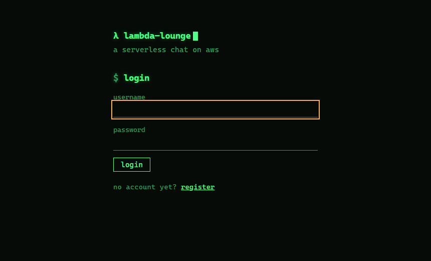
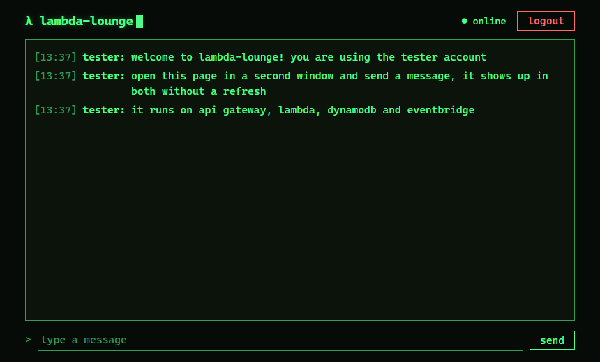

# lambda-lounge

A real-time chat that runs completely on AWS serverless services. There is no server to run or patch, and when nobody is chatting it costs next to nothing.

Live demo: https://58tw0bqtu2.execute-api.eu-west-1.amazonaws.com/Prod/login

Want to try it? Log in with the tester account (username `tester`, password `lambdalounge`), or register your own. Open it in two windows and send a message in one of them, it shows up in the other one straight away.

| Login | Chat |
| --- | --- |
|  |  |

## What it shows

- **Real time.** New messages are pushed to every open browser with an API Gateway websocket, usually in under a second. If the websocket is down the page falls back to polling.
- **Serverless.** API Gateway, Lambda and DynamoDB. Everything is pay per request, and nothing runs when nobody uses it.
- **Event driven.** Every message goes through a DynamoDB Stream, EventBridge and SQS (with a dead letter queue), and a worker counts messages per user for `GET /stats`.
- **Safe by default.** Passwords are hashed with bcrypt, the login cookie is `HttpOnly`, the secret for the tokens is an SSM SecureString, and the API is throttled.
- **Delivered like a real project.** Tests run on every push, then GitHub Actions deploys. It logs in to AWS with OIDC (no stored keys), the deploy role has least privilege with a permissions boundary, and `main` only takes pull requests.
- **Easy to operate.** JSON logs, X-Ray tracing, CloudWatch alarms and a budget alert. All infrastructure is code (AWS SAM / CloudFormation).

## How it fits together

```
browser --REST--> API Gateway --> Lambda (FastAPI) --> DynamoDB (users, messages)
   ^                                                          |
   |                                                    DynamoDB Stream
   |                                                          v
   |                                              Lambda (StreamProcessor)
   |                                                          |
   |                                                          v
   |                                                 EventBridge bus
   |                                                    |            |
   |                                                    v            v
   +--websocket-- API Gateway <-- Lambda (Broadcaster)   SQS queue --> Lambda (StatsConsumer)
                                                          |                  |
                                                          v                  v
                                                dead letter queue    DynamoDB (stats)
```

**Logging in.** `POST /token` checks the password and sets an `HttpOnly` cookie with a token that lasts 30 minutes.

**Live messages.** The websocket is only used for receiving, posting still goes through `POST /messages`. The page asks `GET /ws-token` (needs login) for a ticket that works for 60 seconds and connects with it. The ticket has its own scope, so it can't be used to log in. When a message is posted it passes through the event flow above, and the Broadcaster sends it to everyone who is connected.

**Stats.** The StatsConsumer counts messages for each user, and `GET /stats` returns the top 10. Events are delivered at least once, so a count can in rare cases be too high. If an event fails three times it lands in the dead letter queue and an alarm goes off.

## Built with

| | |
| --- | --- |
| Language | Python 3.12 (FastAPI with Mangum on Lambda) |
| AWS | API Gateway (REST and WebSocket), Lambda, DynamoDB and Streams, EventBridge, SQS, SSM Parameter Store, CloudWatch, X-Ray, SNS |
| Infrastructure | AWS SAM / CloudFormation |
| CI/CD | GitHub Actions, OIDC |
| Tests | pytest, with moto as a fake DynamoDB |
| Frontend | Plain HTML, CSS and JavaScript, no framework |

## Run it locally

You don't need Docker or an AWS account.

```bash
python -m venv .venv
.venv/Scripts/activate        # Windows (Linux/macOS: source .venv/bin/activate)
pip install -r requirements-dev.txt
python dev.py                 # http://localhost:8000/login
pytest
```

`dev.py` uses a fake DynamoDB, so the data is gone when you stop it. There is no websocket locally, so the page polls every 5 seconds, and the stats stay empty because the fake database has no streams.

## Deploy

Every push to `main` runs the tests and then deploys (`.github/workflows/deploy.yml`). It creates the secret for the tokens in SSM the first time, random and never in git, and puts the live demo link at the top of this file when it is done.

GitHub logs in to AWS with OIDC, so there are no access keys anywhere. The role is created once from `infra/github-oidc.yaml`:

```bash
aws cloudformation deploy --template-file infra/github-oidc.yaml --stack-name lambda-lounge-github --capabilities CAPABILITY_NAMED_IAM
```

Then add the role arn (printed as an output) as a repository variable called `AWS_ROLE_ARN`. To get the alarm and budget mails, also set `ALERT_EMAIL` and confirm the subscription mail from AWS:

```bash
gh variable set ALERT_EMAIL --body "you@example.com"
```

To deploy by hand you can still run `sam build` and `sam deploy`, and `sam delete` takes everything down.

## Running it

- Logs are JSON in the log group `/lambda-lounge/api` (and `/lambda-lounge/workers`) and are kept for 14 days.
- X-Ray tracing is on for API Gateway and Lambda.
- Both APIs are throttled to 5 requests per second (burst 10).
- Alarms for Lambda errors, API 5xx, slow requests, broadcaster errors and the dead letter queue, plus a 5 USD monthly budget alert, all go to an SNS topic.

## Where things are

```
app.py, auth/, chat/      the API (FastAPI)
workers/                  the Lambdas for the event flow and the websocket
database/                 DynamoDB helpers
static/                   the web pages
template.yaml             all of the infrastructure
infra/github-oidc.yaml    the role GitHub Actions uses to deploy
tests/                    pytest
```

## Background

This started as my degree project, [chatapp-serverless](https://github.com/houbou98-19/chatapp-serverless) (tag `thesis-final`), which was a proof of concept that used MongoDB Atlas. lambda-lounge is the same idea taken further: DynamoDB instead of Mongo, an event flow, live messages, tests, and a proper pipeline.
